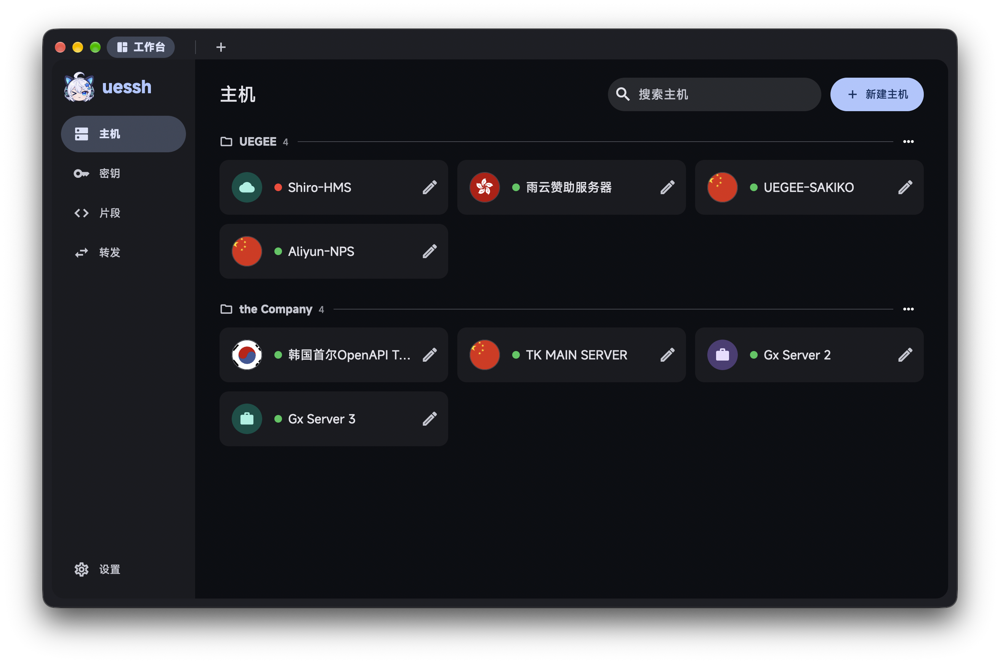
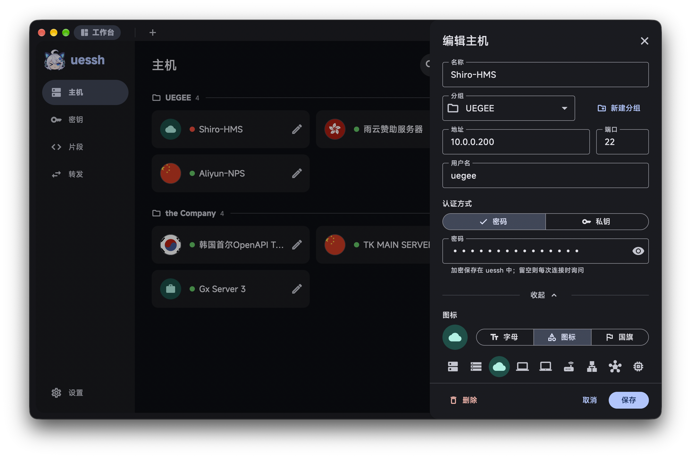
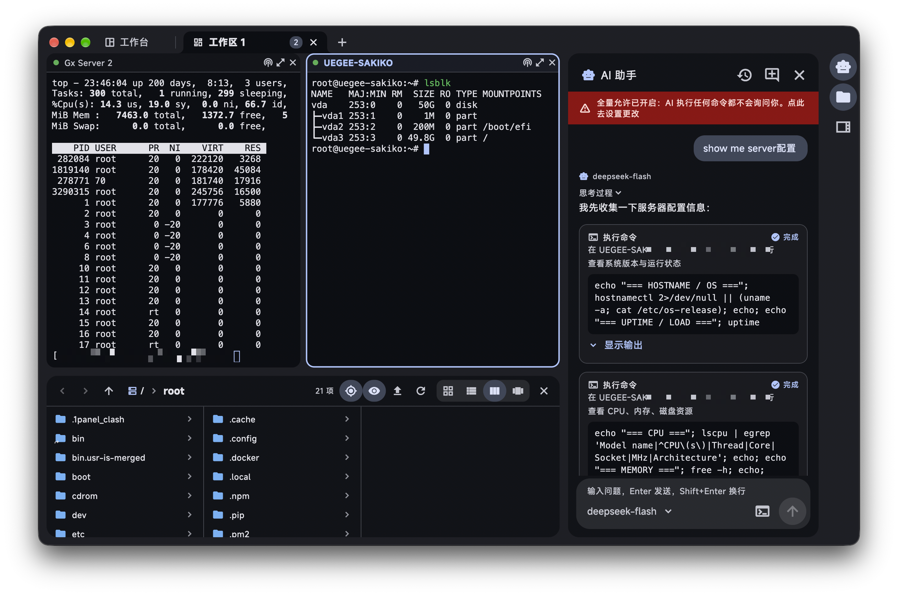
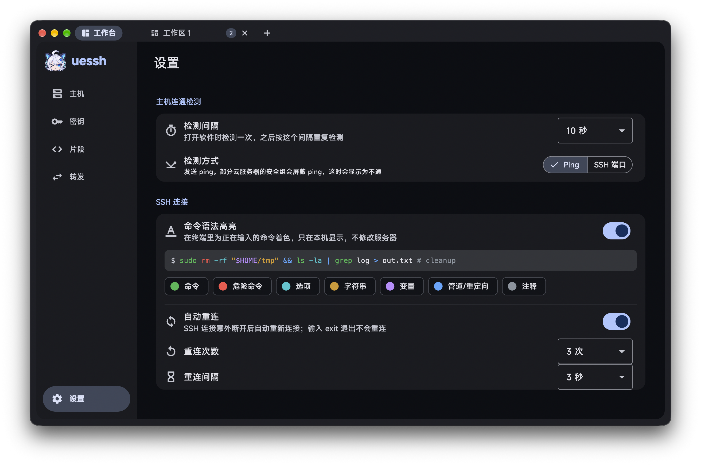

<div align="center">


<h1>UESSH</h1>

<p>一款用 Flutter 开发的 Material Design 3 风格 SSH 客户端，正在绝赞开发中～</p>

<p>
  <a href="https://github.com/ueeedev/uessh/releases/latest"></a>
  
  
  
</p>

目前还处于开发阶段，但是小伙伴们可以通过 [Releases](https://github.com/ueeedev/uessh/releases) 页面下载到最新的发行版尝鲜哦～

</div>

## 简介

UESSH 是一个面向桌面的 SSH 客户端，支持 **macOS** 和 **Windows**。主机管理、终端、文件传输和 AI 助手都放在同一个窗口里，用起来像浏览器一样：第一个标签页是「工作台」，用来管理主机、密钥和设置，后面的每个标签页都是一个 SSH 会话。

目标很简单：**好看、顺手、安全**。

- 🎨 **好看**：遵循 Material Design 3，支持浅色和深色模式，可以跟随系统强调色，界面中文和英文都有
- 🧩 **顺手**：
  - 标签页可以拖动排序，SSH 窗口可以拖成分屏工作区，还能把输入同时广播到多台服务器
  - 文件浏览器跟着终端当前目录走，文件拖进来就能上传
  - 断线会自动重连，正在输入的命令会实时高亮
- 🤖 **AI 助手**：
  - 支持 Claude、ChatGPT、DeepSeek、Gemini、Grok，也可以接入自定义服务商
  - AI 可以帮你在服务器上查看状态、执行命令；敏感操作需要你点确认，执行过程在终端里实时可见
- 🔒 **安全**：
  - 密码、私钥和 API Key 都加密保存在本机保险库中，可以设置主密码和自动锁定
  - 首次连接会校验并记住主机指纹
  - 软件不收集任何数据，SSH 连接都直接从你的电脑发起
  - 只有两种情况会访问其他服务：你给主机选了国旗图标时会查询服务器所在国家（ipwho.is）；使用 AI 助手时，对话会发给你配置的 AI 服务商

## 截图

<table>
  <tr>
    <td></td>
    <td></td>
  </tr>
  <tr>
    <td></td>
    <td></td>
  </tr>
</table>

## 支持的平台

| 平台 | 最低系统版本 | 架构 | 下载文件 |
| --- | --- | --- | --- |
| macOS | macOS 12 Monterey 及以上 | Apple Silicon、Intel（同一个安装包） | `uessh-版本号-macos.dmg` |
| Windows | Windows 10 及以上 | x64（Windows 11 ARM 设备可通过系统自带的转译运行） | 安装包 `uessh-版本号-windows-x64-setup.exe`<br>便携版 `uessh-版本号-windows-x64-portable.zip` |

所有安装包都在 [Releases](https://github.com/ueeedev/uessh/releases/latest) 页面下载。连接服务器只需要对方开启 SSH 服务，服务器上不用安装任何东西。

## 安装与首次运行

> [!IMPORTANT]
> UESSH 目前还没有进行代码签名，第一次打开时系统会拦一下，按下面的步骤放行一次就好，之后可以正常打开。

### macOS

1. 打开下载好的 `.dmg`，把 **uessh** 拖进「应用程序」文件夹。
2. 在「应用程序」中双击打开 uessh，系统会提示「无法打开“uessh”」或「无法验证开发者」，点 **完成**（或 **好**）关掉提示。
3. 打开 **系统设置 → 隐私与安全性**，滚动到页面下方的「安全性」部分，可以看到「已阻止“uessh”以保护 Mac」的提示，点旁边的 **仍要打开**。
4. 再次确认 **仍要打开**，按要求输入登录密码或使用触控 ID，uessh 就会启动了。

之后再打开 uessh 就不会再出现提示。

<details>
<summary>没有看到「仍要打开」按钮？</summary>

- 这个按钮只会在你尝试打开 uessh 之后的一小时内出现，先按第 2 步打开一次，再去系统设置里找。
- 也可以在「终端」里执行下面的命令，去掉下载标记后直接打开：

  ```bash
  xattr -dr com.apple.quarantine /Applications/uessh.app
  ```

</details>

### Windows

- **安装包**：运行 `setup.exe`，按提示完成安装。
- **便携版**：把 `zip` 解压到任意文件夹，运行里面的 `uessh.exe`，无需安装。

如果弹出「Windows 已保护你的电脑」（SmartScreen），点 **更多信息 → 仍要运行** 即可。

## 开发

欢迎您提交 PR！在开始之前，请阅读 [贡献指引](CONTRIBUTING.md) 以了解我们对 PR 和 AI 参与辅助开发的规定。

## 免责声明

本项目基于 GNU 通用公共许可证第 3 版（GPL-3.0）授权。我们不对其适用性、可靠性或准确性作出任何明示或暗示的保证。在法律允许的最大范围内，作者和贡献者不承担任何因使用本软件而产生的直接、间接、偶然、特殊或后果性的损害赔偿责任。

使用本项目需遵守所在地法律法规，不得进行任何侵犯第三方知识产权的行为。因使用本项目而产生的数据和缓存应在 24 小时内清除，超出 24 小时的使用需获得相关权利人的授权。

## 隐私政策

我们不收集任何用户数据，不使用任何遥测组件。
